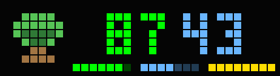
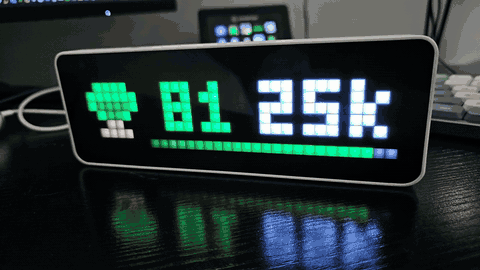
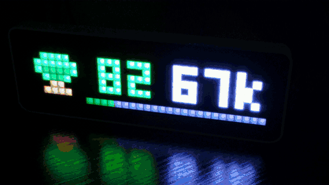

# Ulanzi OSRS Clock

**No hardware needed.** Turn the plugin on and a small LED clock appears on your desktop, showing your hitpoints, prayer, run energy, special attack, and when you have gone AFK. Keep it beside whatever else you are doing and you will see the moment your character needs you.

If you own an [Ulanzi TC001](https://github.com/rroels/ulanzi_tc001_hardware) pixel clock running [AWTRIX NG](https://blueforcer.github.io/awtrix-ng/), the plugin can drive that instead, with the same pages.

A skill page can take over with your level and XP per hour. Low hitpoints flashes across the panel. Level-ups get a short celebration.

## Gallery

## The virtual clock

It is on by default and only appears while you are logged in.

- Drag it anywhere, and drag any edge to resize it.
- Hover over it for **always on top**, **opacity**, **more options**, and **close**. Scrolling over it changes the opacity too.
- **Only when tabbed out** hides it while you are playing and shows it when you switch to another window.
- When no page is up it can show quiet dots, skill icons, the time in 12 or 24 hours, or nothing.
- Nothing is sent over the network, and tones play through your speakers.

## Connect a real clock

Hover over the virtual clock, open its options, and choose **Connect a real clock**, or fill in **Clock address** in the settings. As soon as the clock answers, the virtual one steps aside. To keep both, set **Virtual clock > Show pages on** to **Both**.

### Flash the clock

Stock firmware cannot show a custom page. Flash [AWTRIX NG](https://blueforcer.github.io/awtrix-ng/getting-started/flashing/) once: in Chrome or Edge, choose **Fresh install** and pick the clock's port.

The clock then starts its own Wi-Fi. Join it, read the IP off the panel, and put that in **Clock address**. This plugin does not flash the device.

## Features

- Hitpoints, prayer, run energy, and special attack stay on the panel, in **Compact**, **Big**, or **Focus**
- The skill page shows your level, XP per hour, and a bar toward the next level
- Low hitpoints, low prayer, and a ready special attack take over the panel
- **Combat**, **Skilling**, and **Hybrid** set the panel up for that kind of play
- **Preview** puts a sample page up without logging in
- AFK takes the panel when you go idle
- A forestry event can call out while you chop
- A level-up shows the skill and your new level
- Works **without any hardware**, through a virtual clock on your desktop
- Tones can be **Soft** or **Classic**, and play on the clock, on your computer, or not at all
