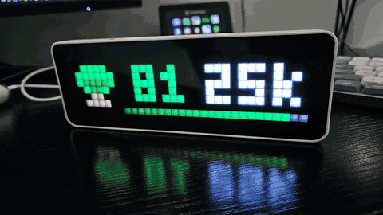
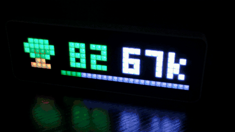
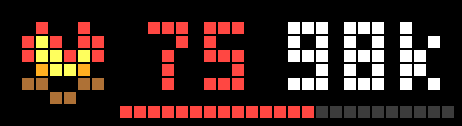
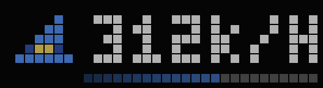
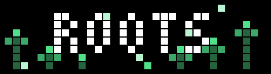
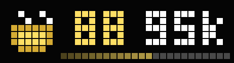
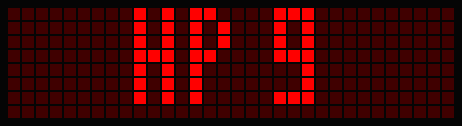
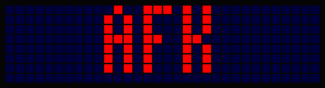
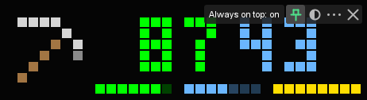

# Ulanzi OSRS Clock

**No hardware needed.** Turn the plugin on and a small LED overlay appears on your desktop with your hitpoints, prayer, run energy, special attack, and AFK status. Own an [Ulanzi TC001](https://github.com/rroels/ulanzi_tc001_hardware) pixel clock running [AWTRIX NG](https://blueforcer.github.io/awtrix-ng/)? The plugin can drive that instead, with the same pages.

## Gallery

Click a picture marked ▶ to watch it move.

### Real clock (Ulanzi TC001)

<table>
<tr>
<td> ▶ Skill page</td>
<td width="14"></td>
<td> ▶ Bar toward the next level</td>
</tr>
</table>

 

### Virtual overlay

<table>
<tr>
<td> Live stats</td>
<td width="14"></td>
<td> ▶ XP drop as a pulse, the default</td>
<td width="14"></td>
<td> ▶ XP drop rising</td>
</tr>
<tr><td height="14"></td></tr>
<tr>
<td> ▶ Level and XP per hour taking turns</td>
<td width="14"></td>
<td> ▶ Forestry events</td>
<td width="14"></td>
<td> Skill page</td>
</tr>
<tr><td height="14"></td></tr>
<tr>
<td> Low hitpoints alert</td>
<td width="14"></td>
<td> AFK</td>
<td width="14"></td>
<td> Hover controls</td>
</tr>
</table>

## Features

- Hitpoints, prayer, run energy, and special attack stay on the panel, in **Compact**, **Big**, or **Focus**
- The skill page shows your level, XP per hour, and a bar toward the next level
- Low hitpoints, low prayer, and a ready special attack take over the panel
- **Combat**, **Skilling**, and **Hybrid** set the panel up for that kind of play
- **Preview** puts a sample page up without logging in
- AFK takes the panel when you go idle
- A forestry event can call out while you chop
- A level-up shows the skill and your new level
- Tones can be **Soft** or **Classic**, and play on the clock, on your computer, or not at all

## Connect a real Ulanzi pixel clock

Hover over the virtual overlay, open its options, and choose **Connect a real Ulanzi pixel clock**, or fill in **Clock address** under **Real clock (Ulanzi TC001)** in the settings. As soon as the clock answers, the overlay steps aside. To keep both, set **Quick setup > Show pages on** to **Both**.

Stock firmware cannot show a custom page. Flash [AWTRIX NG](https://blueforcer.github.io/awtrix-ng/getting-started/flashing/) once: in Chrome or Edge, choose **Fresh install** and pick the clock's port. The clock then starts its own Wi-Fi. Join it, read the IP off the panel, and put that in **Clock address**. This plugin does not flash the device.
