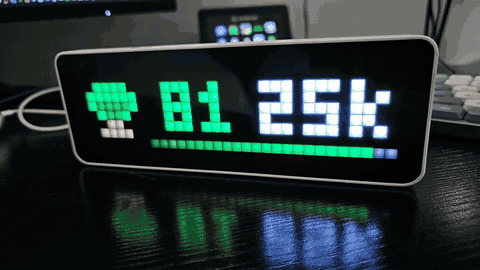
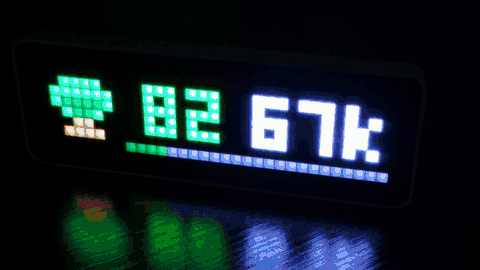

# Ulanzi OSRS Clock

Shows what you are doing in Old School RuneScape on an [Ulanzi TC001](https://github.com/rroels/ulanzi_tc001_hardware) pixel clock running [AWTRIX NG](https://blueforcer.github.io/awtrix-ng/).

Hitpoints, prayer, run energy, and special attack stay on the 32×8 panel while you play, with an icon for the skill you are training or the combat style you are using. A skill page can take over with your level and XP per hour. Low hitpoints flashes across the panel. Level-ups get a short celebration.

## Gallery

## Flash the clock

Stock firmware cannot show a custom page. Flash [AWTRIX NG](https://blueforcer.github.io/awtrix-ng/getting-started/flashing/) once: in Chrome or Edge, choose **Fresh install** and pick the clock's port.

The clock then starts its own Wi-Fi. Join it, read the IP off the panel, and put that in **Clock address**. This plugin does not flash the device.

## Features

- Hitpoints, prayer, run energy, and special attack stay on the panel, in **Compact**, **Big**, or **Focus**
- The skill page shows your level, XP per hour, and a bar toward the next level
- Low hitpoints, low prayer, and a ready special attack take over the panel
- **Combat**, **Skilling**, and **Hybrid** set the panel up for that kind of play
- **Preview** puts a sample page on the clock without logging in
- AFK takes the panel when you go idle
- A forestry event can call out while you chop
- A level-up shows the skill and your new level
